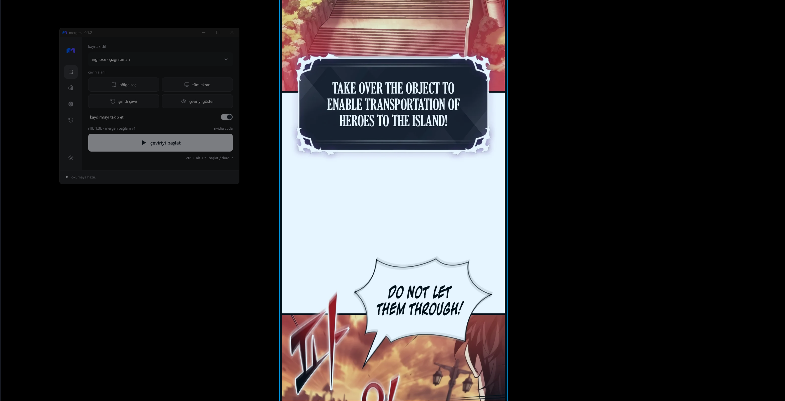
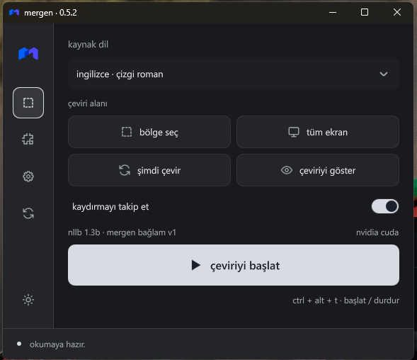
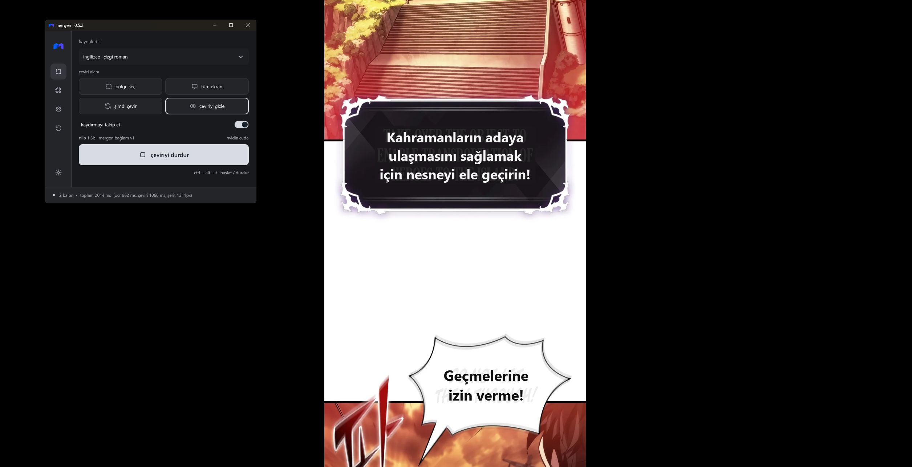

# mergen · hikâyenin diline takılma

  

mergen; **manga, manhwa, manhua, webtoon ve çizgi romanları türkçe okumayı kolaylaştırmak** için geliştirilen bir masaüstü uygulamasıdır. ekrandaki konuşma balonlarını ve yazıları okur, türkçeye çevirir ve çeviriyi metnin üzerinde gösterir.

okuduğun siteyi veya görüntüleyiciyi değiştirmeden, sayfaları tek tek dışa aktarmadan okumaya devam edebilirsin. çeviri katmanı tıklamalarını engellemez; sayfayı kaydırırken çeviri alanı takip edilir. kurulum paketi ve çalışma kütüphaneleri hazırlandıktan sonra metin tanıma ve çeviri bilgisayarında çalışır.

## ekran görüntüleri

**çeviri öncesi**

**kontrol paneli**

  

**çeviri sonrası**

## neler sunar?

- japonca manga, korece manhwa ve webtoon, çince manhua ve ingilizce çizgi romanlar için türkçe çeviri.
- seçili bölge veya tüm ekran üzerinden okuma; konuşma balonlarını ve metin gruplarını dikkate alan işleme.
- japonca dikey metinler için okuma düzeni ve manga-ocr desteği.
- çeviri katmanının yazı tipi, boyutu ve saydamlığını ayarlama; ekran paylaşımında görünürlüğünü seçme.
- cihazına göre cpu veya desteklenen ekran kartı ortamını seçme; çalışma kütüphanelerini uygulama içinden kurma ve modelleri yönetme.

## kullandığımız modeller

mergen iki aşamada çalışır: **önce görseldeki yazıyı okur, ardından okunan metni türkçeye çevirir.** metin tanıma ve çeviri için farklı modeller kullanılır.

| görev | model | uygulamadaki yeri |
|---|---|---|
| türkçe çeviri | [nllb-200 distilled 600m](https://huggingface.co/facebook/nllb-200-distilled-600M) | varsayılan çeviri seçeneği; daha düşük bellek tüketimi için başlangıç modeli. |
| türkçe çeviri | [nllb mergen bağlam v1](https://github.com/tu5j4/nllb-mergen-baglam-v1) | nllb-200 distilled 1.3b tabanlı, ingilizce–türkçe için uyarlanmış bağlamlı çeviri seçeneği. |
| japonca metin tanıma | [manga-ocr-base](https://huggingface.co/kha-white/manga-ocr-base) | japonca manga yazılarını okumak için kullanılan, isteğe bağlı manga-ocr modeli. |
| metin tespiti ve tanıma | [paddleocr · pp-ocrv5 mobil](https://github.com/PaddlePaddle/PaddleOCR) | `pp-ocrv5_mobile_det` ve `pp-ocrv5_mobile_rec`; metnin yerini bulma ve yazıyı okuma. `pp-lcnet_x1_0_textline_ori` satır yönünü belirlemeye yardımcı olur. |
| korece metin tanıma | `korean_pp-ocrv5_mobile_rec` | korece manhwa ve webtoon metinleri için tanıma modeli. |

600m için cpu ve nvidia çevirisinde ctranslate2, amd ve intel çevirisinde transformers/pytorch kullanılır. bağlamlı 1.3b bütün cihazlarda pytorch ve peft kullanır; cpu fp32, nvidia bf16 yoluyla çalışır. amd/intel bağlamlı model yolu bu sürümde donanım üzerinde doğrulanmadı. intel tarafında yerel pytorch xpu yolu bulunur. bunlar modelleri çalıştıran altyapılardır; çeviri modellerimiz nllb’dir. amd ve intel seçenekleri deneyseldir ve desteklenen donanım/sürücü gerektirir.

## kurulum ve kullanım

1. [güncel kurulum paketini releases bölümünden indir](https://github.com/tu5j4/mergen/releases/latest) ve uygulamayı kur.
2. `mergen-setup-0.5.2.exe` dosyasını çalıştır. uygulama kurulumu büyük model ağırlıklarını içermez. ilk hazırlıkta gereken sabit modeller merkezi model yayınlarından indirilir; boyutları ve sha256 özetleri doğrulanır. mevcut doğru modeller sonraki uygulama sürümlerinde yeniden indirilmez. donanım taramasından sonra uygun çalışma kütüphaneleri kurulur; gpu kurulumu veya gerçek model testi geçmezse cpu ile devam edilir. aynı işlem **modeller** sayfasından başlatılabilir.
3. kaynak dili seç; **bölge seç** ile okuma alanını işaretle veya **tüm ekran** seçeneğini kullan.
4. **çeviriyi başlat** düğmesine bas ve okumaya devam et. gerekirse **şimdi çevir** ile yeniden dene.

`ctrl+alt+t` çeviriyi başlatır/durdurur; `ctrl+alt+h` çeviri katmanını gizler/gösterir.

windows 10/11 x64, avx destekli işlemci ve kurulum sırasında geçici dosyalar dahil yeterli boş alan gerekir. model paketi ve çalışma kütüphanelerinin ilk kurulumu internet bağlantısı gerektirir. model adresleri ve dosya özetleri sabittir; değişken hub ağırlıkları kullanılmaz. model yayınları uygulama sürümünden bağımsızdır; aynı büyük nllb dosyaları her uygulama güncellemesi için tekrar yayımlanmaz. hız ve bellek kullanımı seçilen model ve donanıma; çeviri sonucu da metnin doğru okunmasına bağlıdır. küçük, stilize veya düşük çözünürlüklü yazılarda sonuçlar değişebilir.

## bağlamlı çeviri

**nllb mergen bağlam v1**, güncel repliği önceki en fazla üç kaynak replikle birlikte değerlendirir. her replik için ayrı dikkat maskesi kullanır; dil ve okuma oturumu değiştiğinde bağlam temizlenir. gpu üzerinde lora bellekte birleştirilir ve en fazla üç replik birlikte işlenir. standart 600m seçeneği korunur. uyarlama ingilizce–türkçe için eğitilmiştir; diğer dillerde aynı kalite garanti edilmez.

## kaynak kod ve lisans

kaynak koddan çalıştırmak için `kurulum.bat`, ardından `baslat.bat` dosyasını kullan. kurulum kaynak `.data` klasöründeki modelleri doğrular, kurulu uygulamadaki doğru kopyalardan yararlanır ve eksikleri aynı merkezi sabit model yayınlarından sağlar. modeller zaten doğruysa büyük ağırlıklar yeniden indirilmez. kaynak ve kurulu uygulamanın ayrı model kopyaları ayrı yer kaplar. python ve arayüz ortamları uygulamaya özeldir; sistem python ve ekran kartı sürücüleri değiştirilmez. ayrıntılar: [kurulum](docs/kurulum.md) · [derleme](docs/derleme.md).

uygulama kodu mit lisanslıdır. nllb modelleri cc-by-nc 4.0 lisansıyla ticari olmayan kullanım içindir. diğer modeller ve kütüphaneler için [üçüncü taraf bildirimlerine](THIRD_PARTY_NOTICES.md) bakabilirsin.
